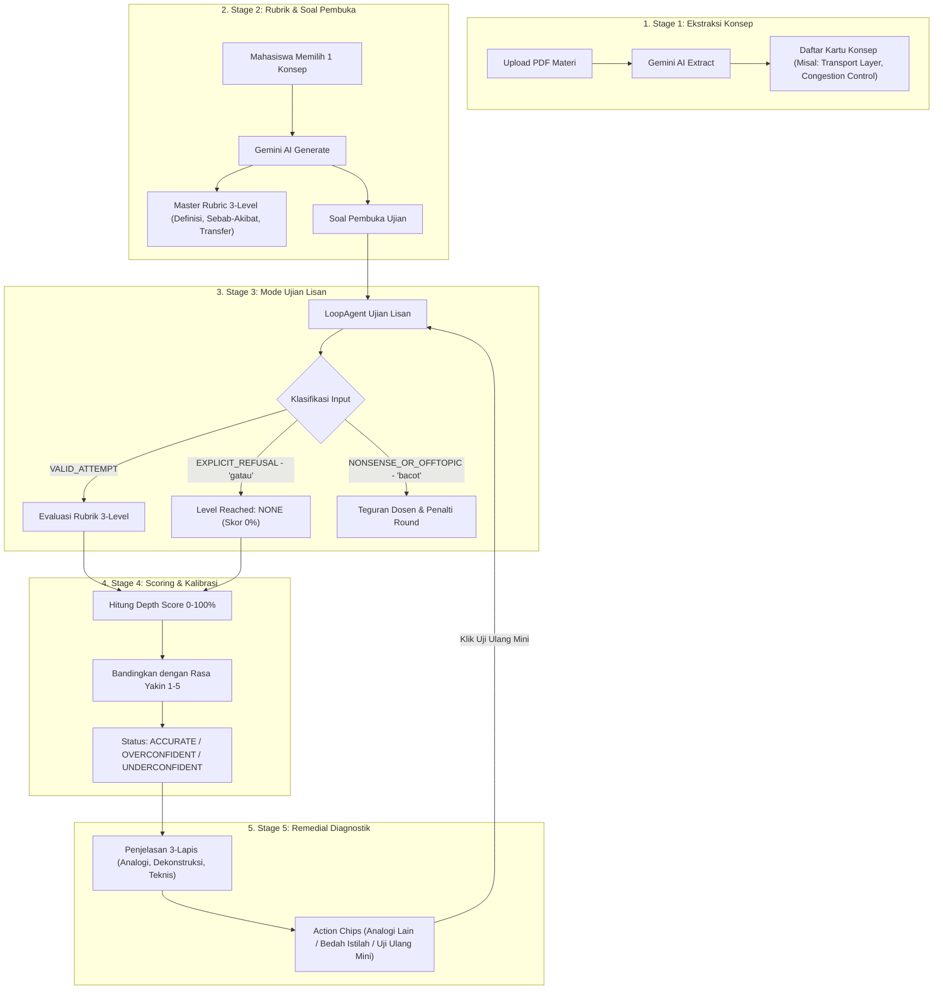

# 💡 Panduan Presentasi Tim: Cara Kerja, Tech Stack, & Flow Sistem AI Nalar

**Dokumen Internal Tim Nalar**  
**Penyaji Presentasi:** Zidan  
**Tujuan Dokumen:** Panduan & Bahan Presentasi Komprehensif untuk Tim Backend (Lukman & Haikal), Frontend (Andika & Mahardika), dan UI/UX (Thomas).

---

## 🛠️ 1. Alasan Pemilihan Tech Stack (Teknologi yang Digunakan)

Berikut adalah alasan strategis di balik pemilihan *Technology Stack* pada Modul AI Nalar:

| Komponen | Teknologi | Alasan Pemilihan & Keunggulan |
|---|---|---|
| **Bahasa Pemrograman** | **Python** | Bahasa standar industri AI dengan ekosistem pustaka pemrosesan teks & LLM terlengkap. |
| **API Framework** | **FastAPI** | Framework microservice yang **super cepat (async)**, *type-safe*, dan otomatis membuat dokumentasi API Swagger (`/docs`). |
| **LLM Engine** | **Google Gemini API (Gemini Flash)** | **Gemini Flash** dipilih sebagai LLM utama karena kecepatannya ultra-tinggi, *cost-efficient*, dan kemampuan penalaran (*reasoning*) yang sangat kuat untuk evaluasi rubrik lisan. *(Catatan: Kita menghindari Gemini Pro untuk pemakaian rutin agar hemat kuota & mencegah latency tinggi).* |
| **Agent Framework** | **Google ADK (LoopAgent)** | Framework Agentic AI khusus untuk mengelola **Adaptive Dialogue Engine (Stage 3)** dalam melakukan ujian lisan berulang (*drill-down turns*). |
| **Validasi Output** | **Pydantic** | **WAJIB untuk semua output LLM**. Menjamin JSON dari AI di-parse & divalidasi 100% *type-safe* sebelum dikirim ke database/frontend, mencegah *data corruption*. |
| **Database utama** | **PostgreSQL (Supabase)** | Database relational *Single Source of Truth* untuk menyimpan materi, graf konsep, rubrik, dan riwayat skor kalibrasi. |

---

## 🎯 2. Filosofi Utama: Mengapa Nalar Berbeda dari Chatbot Biasa?

Nalar **bukan sekadar AI Chatbot** (seperti ChatGPT biasa) yang langsung memberikan jawaban instan. Nalar adalah **AI Oral Examiner & Diagnostic Learning Tool** dengan **Dual Flow (Dua Mode)**:

1. **Mode Ujian Lisan**: Penguji yang tegas, adaptif, dilarang membocorkan jawaban, tahan kata iseng/gatau.
2. **Mode Belajar Diagnostik**: Konsultan belajar yang memberikan penjelasan 3-Lapis (Analogi, Dekonstruksi Misconception, Teknis Slide) + Action Chips & Uji Ulang Mini.

---

## 🔄 3. Alur Utama Sistem AI (5-Stage System Flow)

Berikut adalah diagram alur kerja 5 Stage AI Nalar:

---

### 📍 Penjelasan Detail 5 Stage (Bahasa Sederhana):

#### 1️⃣ Stage 1: Pembedahan Materi (Ekstraksi Konsep)
* **Analogi**: *"Membongkar buku slide dosen dan mengambil topik-topik paling penting."*
* **Cara Kerja**: Pengguna mengunggah PDF materi kuliah (misal 30 slide) ➔ AI mengekstraksi topik-topik utama di dalamnya.
* **Maksud dari "Daftar konsep yang siap dipilih oleh mahasiswa"**:
  Satu file PDF slide dosen bisa berisi banyak topik (misal: *Transport Layer*, *Congestion Control*, *TCP Handshake*). AI menyajikan topik-topik ini sebagai **pilihan kartu di antarmuka UI**. Mahasiswa tinggal **mengklik salah satu topik** yang ingin ia uji pemahamannya!

---

#### 2️⃣ Stage 2: Penyusunan Kisi-Kisi & Soal Ujian (Master Rubric)
* **Analogi**: *"Dosen AI menyiapkan rubrik penilaian lisan dari yang paling mudah sampai yang tersulit."*
* **Cara Kerja**: Begitu mahasiswa memilih 1 topik (misal *Transport Layer*), AI menyusun **Master Rubric 3-Tingkat Pemahaman (Bloom's Taxonomy)**:
  1. **Level Definisi**: Pengertian dasar konsep.
  2. **Level Sebab-Akibat**: Hubungan dampak jika terjadi masalah/gangguan.
  3. **Level Transfer**: Penerapan pada skenario kasus nyata.
* **Hasil**: Rubrik Penilaian + **Soal Pembuka Ujian**.

---

#### 3️⃣ Stage 3: Ujian Lisan Interaktif (Mode Ujian)
* **Analogi**: *"Sesi tanya-jawab lisan langsung di depan dosen penguji."*
* **Cara Kerja**: AI mengajukan pertanyaan ➔ Mahasiswa menjawab ➔ AI mengevaluasi secara ketat terhadap Rubrik Stage 2.
* **Fitur Keamanan AI di Stage 3**:
  * 🛡️ **Tahan Iseng ("bacot"/ngasal)**: AI memberikan teguran tegas & penalti round.
  * 🛑 **Tahan Jawaban Nol ("gatau"/menyerah)**: Ujian langsung dihentikan sopan, nilai di-set `0%` (`level_reached: "none"`), dan dipindah ke Mode Belajar.
  * 🗣️ **Toleransi Bahasa Gaul Teknis**: Jawaban mahasiswa IT (*"L4 OSI bro, handle port multiplexing..."*) tetap dinilai pintar & valid!

---

#### 4️⃣ Stage 4: Penilaian Kedalaman & Ukuran Sadar Diri (Calibration Score)
* **Analogi**: *"Mengukur seberapa jago pemahamanmu vs seberapa pede (percaya diri) kamu."*
* **Cara Kerja**:
  * AI menghitung **Depth Score (0 - 100%)** berdasarkan level tertinggi yang berhasil dibuktikan mahasiswa di Stage 3.
  * Mahasiswa memilih skala rasa yakinnya (**1/5 s/d 5/5**).
  * AI menghitung **Delta Kalibrasi** dan mendeteksi kondisi psikologis pemahaman:
    * 🎯 **`ACCURATE`**: Paham 80% dan merasa yakin 80% (Sadar Diri).
    * ⚠️ **`OVERCONFIDENT`**: Paham 0% (menjawab "gatau") tapi merasa yakin 100% (Sangat Bahaya!).
    * 🌟 **`UNDERCONFIDENT`**: Paham 100% sempurna di level Transfer tapi merasa ragu 20% (Diberi apresiasi hangat oleh AI!).

---

#### 5️⃣ Stage 5: Mode Belajar Diagnostik 3-Lapis & Tombol Aksi (Diagnostic Remedial)
* **Analogi**: *"Dokter spesialis yang menjelaskan letak penyakit pemahamanmu dan cara menyembuhkannya."*
* **Cara Kerja**: AI menyusun penjelasan diagnostik yang dipersonalisasi menjadi **3 Lapis**:
  1. ⚓ **Mental Anchor Analogy**: Analogi dunia nyata yang mudah dibayangkan.
  2. 🎯 **Dekonstruksi Misconception**: Letak persis kekeliruan jawaban mahasiswa saat ujian tadi.
  3. 📚 **Jembatan Teknis Slide Dosen**: Penjelasan akademis resmi yang terhubung kembali ke slide dosen.
* **Fitur Interaktif Action Chips**:
  * `💡 Bikin Analogi Lain`: Minta analogi dunia nyata alternatif.
  * `🔍 Bedah Istilah`: Minta penjelasan sederhana untuk kata/kalimat yang belum dipahami.
  * `🧪 Uji Ulang Mini`: Menampilkan soal uji ulang singkat + kotak teks jawaban langsung untuk membuktikan pemahaman baru ke Stage 3!

---

## 🎬 4. Contoh Skenario Penggunaan Nyata (Real Case Study)

Mari kita bayangkan seorang mahasiswa bernama **Rian**:

1. **Rian Upload PDF** Slide Jaringan Komputer Bab 3.
2. **Stage 1 (Ekstraksi Konsep)**: AI membaca PDF dan menampilkan 3 kartu konsep (*Transport Layer*, *Congestion Control*, *TCP Handshake*).
3. **Rian Memilih Kartu Konsep** `Transport Layer (Bab 3)`.
4. **Sesi Ujian (Stage 3)**:
   * **Dosen AI**: *"Apa yang dimaksud Transport Layer?"*
   * **Rian (Bahasa Gaul)**: *"L4 OSI bro, handle port multiplexing ama flow control biar gak packet loss."*
   * **Dosen AI**: *"Bagus! Lulus Level Definisi. Sekarang untuk Level Sebab-Akibat: Apa yang terjadi jika router mengalami buffer overflow?"*
   * **Rian**: *"Auto packet loss bro, TCP kudu retrans segmen."* ➔ **Lulus Level Sebab-Akibat!**
5. **Kalibrasi Skor (Stage 4)**:
   * Depth Score: **70%** (Sebab-Akibat).
   * Rian merasa Yakin 4/5 (75%).
   * Status: **`ACCURATE`** (Pemahaman Rian sejalan dengan rasa yakinnya).
6. **Mode Belajar (Stage 5)**:
   * AI memberikan penjelasan 3 lapis untuk menyempurnakan sisa pemahaman Rian hingga level Transfer.
   * Rian mengklik **`🧪 Uji Ulang Mini`**, mengetik jawaban baru, dan membuktikan pemahamannya 100% sempurna!

---

## 💡 5. Kesimpulan untuk Tim

Modul AI Nalar Microservice ini telah dibangun dengan **skema data Pydantic yang valid**, **bebas error**, **tahan terhadap uji coba kasar/gaul**, serta memiliki **web sandbox interaktif di `http://127.0.0.1:8000/playground`** yang siap dikonsumsi oleh tim Backend & Frontend!
