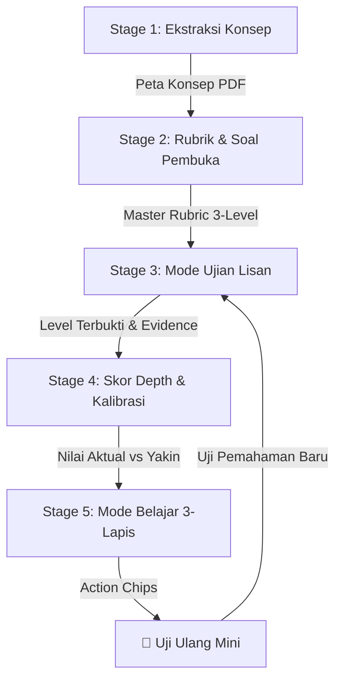

# 💡 Panduan Presentasi Tim: Cara Kerja & Alur Sistem AI Nalar (5-Stage Engine)

**Dokumen Internal Tim Nalar**  
**Penyaji Presentasi:** Zidan (AI Engineer)  
**Tujuan Dokumen:** Bahan presentasi sederhana untuk menjelaskan alur kerja modul AI Nalar kepada tim Backend, Frontend, dan UI/UX.

---

## 🎯 1. Filosofi Utama: Mengapa Nalar Berbeda dari Chatbot Biasa?

Nalar **bukan sekadar AI Chatbot** (seperti ChatGPT biasa) yang langsung memberikan jawaban instant. 

Nalar dirancang sebagai **"Dosen Penguji Ujian Lisan & Konsultan Belajar Diagnostik"** dengan **DUAL FLOW (Dua Mode)**:

```
                  ┌─────────────────────────────────────────┐
                  │          MODUL AI NALAR ENGINE          │
                  └────────────────────┬────────────────────┘
                                       │
            ┌──────────────────────────┴──────────────────────────┐
            ▼                                                     ▼
  [MODE UJIAN LISAN]                                   [MODE BELAJAR DIAGNOSTIK]
  • Ujian lisan interaktif adaptif                     • Penjelasan 3-Lapis (Analogi,
  • DILARANG membocorkan jawaban                       Dekonstruksi, Teknis Slide)
  • Tahan kata iseng / jawaban nol                     • Action Chips & Uji Ulang Mini
```

---

## 🔄 2. Alur Utama Sistem AI (5-Stage System Flow)

Sistem AI Nalar bekerja dalam **5 Tahapan (Stage)** sekuensial yang saling terhubung secara otomatis:



---

### 📍 Pembedahan Detail 5 Stage (Bahasa Sederhana):

#### 1️⃣ Stage 1: Pembedahan Materi (Ekstraksi Konsep)
* **Analogi**: *"Seperti membongkar buku slide dosen dan mengambil topik-topik paling penting."*
* **Cara Kerja**: Pengguna mengunggah PDF materi kuliah ➔ AI membaca teksnya ➔ AI menghasilkan daftar **Graf Konsep** (Nama Konsep, Definisi, Rujukan Slide, dan Konsep Terkait).
* **Hasil**: Daftar konsep yang siap dipilih oleh mahasiswa.

---

#### 2️⃣ Stage 2: Penyusunan Kisi-Kisi & Soal Ujian (Master Rubric)
* **Analogi**: *"Dosen AI menyiapkan rubrik penilaian lisan dari yang paling mudah sampai yang tersulit."*
* **Cara Kerja**: AI mengambil 1 konsep yang dipilih ➔ AI menyusun **Master Rubric 3-Tingkat Pemahaman (Bloom's Taxonomy)**:
  1. **Level Definisi**: Mahasiswa tahu pengertian dasarnya.
  2. **Level Sebab-Akibat**: Mahasiswa tahu hubungan dampak jika terjadi masalah.
  3. **Level Transfer**: Mahasiswa bisa menerapkan ke studi kasus nyata.
* **Hasil**: Rubrik Penilaian + **Soal Pembuka Ujian**.

---

#### 3️⃣ Stage 3: Ujian Lisan Interaktif (Mode Ujian)
* **Analogi**: *"Sesi tanya-jawab lisan langsung di depan dosen penguji."*
* **Cara Kerja**: 
  * AI mengajukan pertanyaan ➔ Mahasiswa menjawab.
  * AI mengevaluasi jawaban secara ketat terhadap Rubrik Stage 2.
  * Jika mahasiswa lulus Level 1 ➔ AI menaikkan ke Level 2 (Sebab-Akibat).
* **Fitur Keamanan AI di Stage 3**:
  * 🛡️ **Tahan Iseng ("bacot"/ngasal)**: AI memberikan teguran tegas & penalti round.
  * 🛑 **Tahan Jawaban Nol ("gatau"/menyerah)**: Ujian langsung dihentikan sopan, nilai di-set `0%` (`level_reached: "none"`), dan dipindah ke Mode Belajar.
  * 🗣️ **Toleransi Bahasa Gaul Teknis**: Jawaban mahasiswa IT (*"L4 OSI bro, handle port multiplexing..."*) tetap dinilai pintar & valid!

---

#### 4️⃣ Stage 4: Penilaian Kedalaman & Ukuran Sadar Diri (Calibration Score)
* **Analogi**: *"Mengukur seberapa jago pemahamanmu vs seberapa pede (percaya diri) kamu."*
* **Cara Kerja**:
  * AI menghitung **Depth Score (0 - 100%)** berdasarkan level tertinggi yang berhasil dibuktikan mahasiswa di Stage 3.
  * Mahasiswa memilih skala rasa yakinnya (**1/5 s/d 5/5**).
  * AI menghitung **Delta Kalibrasi** dan mendeteksi kondisi psikologis pemahaman:
    * 🎯 **`ACCURATE`**: Paham 80% dan merasa yakin 80% (Sadar Diri).
    * ⚠️ **`OVERCONFIDENT`**: Paham 0% (menjawab "gatau") tapi merasa yakin 100% (Sangat Bahaya!).
    * 🌟 **`UNDERCONFIDENT`**: Paham 100% sempurna di level Transfer tapi merasa ragu 20% (Diberi apresiasi hangat oleh AI!).

---

#### 5️⃣ Stage 5: Mode Belajar Diagnostik 3-Lapis & Tombol Aksi (Diagnostic Remedial)
* **Analogi**: *"Dokter spesialis yang menjelaskan letak penyakit pemahamanmu dan cara menyembuhkannya."*
* **Cara Kerja**: AI menyusun penjelasan diagnostik yang dipersonalisasi menjadi **3 Lapis**:
  1. ⚓ **Mental Anchor Analogy**: Analogi dunia nyata yang mudah dibayangkan (contoh: *"Transport Layer seperti satpam/kurir pengatur paket di gedung..."*).
  2. 🎯 **Dekonstruksi Misconception**: Letak persis kekeliruan jawaban mahasiswa saat ujian tadi.
  3. 📚 **Jembatan Teknis Slide Dosen**: Penjelasan akademis resmi yang terhubung kembali ke slide dosen.
* **Fitur Interaktif Action Chips (Maksimal 3 Turn)**:
  * `💡 Bikin Analogi Lain`: Minta analogi dunia nyata alternatif.
  * `🔍 Bedah Istilah`: Minta penjelasan sederhana untuk kata/kalimat yang belum dipahami.
  * `🧪 Uji Ulang Mini`: Menampilkan soal uji ulang singkat + kotak teks jawaban langsung untuk membuktikan pemahaman baru ke Stage 3!

---

## 🎬 3. Contoh Skenario Penggunaan Nyata (Real Case Study)

Mari kita bayangkan seorang mahasiswa bernama **Rian**:

1. **Rian Upload PDF** Slide Jaringan Komputer Bab 3.
2. **AI Mengekstraksi Konsep** `Transport Layer (Bab 3)` (Stage 1 & 2).
3. **Sesi Ujian (Stage 3)**:
   * **Dosen AI**: *"Apa yang dimaksud Transport Layer?"*
   * **Rian (Bahasa Gaul)**: *"L4 OSI bro, handle port multiplexing ama flow control biar gak packet loss."*
   * **Dosen AI**: *"Bagus! Lulus Level Definisi. Sekarang untuk Level Sebab-Akibat: Apa yang terjadi jika router mengalami buffer overflow?"*
   * **Rian**: *"Auto packet loss bro, TCP kudu retrans segmen."* ➔ **Lulus Level Sebab-Akibat!**
4. **Kalibrasi Skor (Stage 4)**:
   * Depth Score: **70%** (Sebab-Akibat).
   * Rian merasa Yakin 4/5 (75%).
   * Status: **`ACCURATE`** (Pemahaman Rian sejalan dengan rasa yakinnya).
5. **Mode Belajar (Stage 5)**:
   * AI memberikan penjelasan 3 lapis untuk menyempurnakan sisa pemahaman Rian hingga level Transfer.
   * Rian mengklik **`🧪 Uji Ulang Mini`**, mengetik jawaban baru, dan membuktikan pemahamannya 100% sempurna!

---

## 💡 4. Kesimpulan untuk Tim

Modul AI Nalar Microservice ini telah dibangun dengan **skema data Pydantic yang valid**, **bebas error**, **tahan terhadap uji coba kasar/gaul**, serta memiliki **web sandbox interaktif di `http://127.0.0.1:8000/playground`** yang siap dikonsumsi oleh tim Backend & Frontend!
