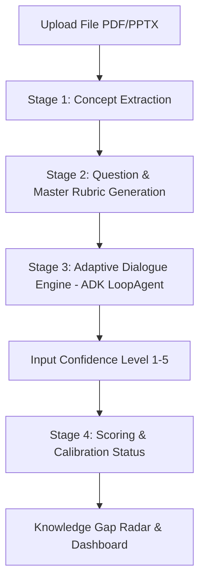

# 🧠 Nalar

> **"Bukan sekadar benar. Tapi seberapa paham."**

[](https://www.python.org/)
[](https://fastapi.tiangolo.com/)
[](https://ai.google.dev/)
[](https://supabase.com/)
[](LICENSE)

---

## 📌 Tentang Nalar

**Nalar** adalah platform AI *Pre-exam Understanding Verification Tool* (AI Oral Examiner) yang mensimulasikan ujian lisan/sidang akademis berbasis materi kuliah pengguna sendiri (PDF/PPTX/catatan). 

Nalar tidak menguji sekadar benar atau salah seperti kuis/flashcard konvensional, melainkan mengukur **kedalaman pemahaman murni** dan mendeteksi apakah mahasiswa mengalami *overconfidence* (merasa sudah paham padahal sebenarnya belum).

---

## 🔥 Fitur Utama (MVP Phase 1)

1. **Adaptive Interrogation Engine (Penguji Adaptif)**
   * Pengujian berjenjang berbasis *Bloom's Taxonomy* (`definisi` ➔ `sebab-akibat` ➔ `transfer`).
   * **Mode Ujian (Hard Rule)**: AI bertindak sebagai dosen penguji tegas dan **dilarang** membocorkan jawaban atau menjelaskan materi selama pengujian.
2. **Confidence Calibration & Skor Kesadaran Diri**
   * Mengukur rasa yakin (*self-reported* skala 1-5) sebelum skor ditampilkan dan membandingkannya dengan *Depth Score* aktual.
   * Mendeteksi kategori: **`overconfident`** *(prioritas belajar tertinggi)*, **`underconfident`**, atau **`accurate`**.
3. **Understanding Depth Score + Evidence Trail**
   * Memberikan skor kedalaman pemahaman (0-100%) yang disertai kutipan bukti (*evidence trail*) dari jawaban pengguna.
4. **Knowledge Gap Radar**
   * Peta pemetaan visual konsep yang sudah dikuasai vs yang masih menjadi celah pemahaman.
5. **Mode Dosen (Institusional)**
   * Dosen dapat membuat kelas, mengunggah silabus, dan memantau *dashboard aggregate & individual* pemahaman kelas berbasis persetujuan (*explicit consent*).

---

## 📐 Arsitektur Pipeline Teknis



---

## 📂 Struktur Repositori

```text
Nalar/
├── README.md                      # Dokumentasi Utama Repositori
├── Gemini.md                      # Rules & Konvensi Modul AI
├── Nalar-Dokumen-Perancangan-Produk.md # Dokumen Konsep Produk Lengkap
├── ai-service/                    # Microservice AI (Python + FastAPI)
│   ├── .env.example               # Template Konfigurasi Environment
│   ├── requirements.txt           # Dependency Python (FastAPI, Google GenAI, ADK)
│   └── app/
│       ├── main.py                # Entrypoint Utama FastAPI Server
│       ├── config.py              # Konfigurasi Pydantic Settings
│       ├── agents/                # Google ADK LoopAgent Engine (Stage 3)
│       ├── endpoints/             # REST Route Handlers (Stage 1 - 4)
│       ├── prompts/               # System Prompts (.md)
│       ├── schemas/               # Pydantic Output Contracts
│       └── services/              # Logika Matematika Scoring & Calibration
└── docs/
    └── PRD/
        ├── prd-ai-module.md       # PRD Teknis Modul AI
        ├── context/               # Dokumen Konteks Tim & Workflow
        └── contracts/             # Contracts API, Output AI, & DB Schema
```

---

## 🚀 Panduan Memulai AI Service (Lokal)

### 1. Prasyarat
* Python 3.13+
* Google Gemini API Key (dapat diperoleh gratis di [Google AI Studio](https://aistudio.google.com/))

### 2. Instalasi & Setup
```bash
# Masuk ke folder service AI
cd ai-service

# Buat & aktifkan virtual environment (Opsional)
python -m venv .venv
source .venv/bin/activate  # Linux/Mac
# atau .venv\Scripts\activate # Windows

# Install dependency
pip install -r requirements.txt

# Setup variabel lingkungan (.env)
cp .env.example .env
```

Buka file `.env` dan masukkan API Key Gemini Anda:
```env
GEMINI_API_KEY=your_actual_gemini_api_key
DEFAULT_LLM_MODEL=gemini-3.6-flash
```

### 3. Jalankan Server
```bash
python -m uvicorn app.main:app --reload --port 8000
```
Buka browser di `http://localhost:8000/docs` untuk membuka dokumentasi interaktif Swagger UI.

---

## 🤝 Pembagian Tim

| Anggota Tim | Peran & Fokus |
|---|---|
| **Zidan** | **AI Engineering**: Concept Extraction, Rubric Gen, Adaptive Engine, Scoring & Calibration |
| **Lukman & Haikal** | **Backend Engineering**: Core Database, Supabase Auth, REST API Gateway, Mode Dosen |
| **Andika & Mahardika** | **Frontend Engineering**: Flow Mahasiswa, UI Tanya-Jawab, Gap Radar & Dashboard |
| **Thomas** | **UI/UX Design**: Wireframe, Design System, & Persona AI Examiner |

---

## 📝 Lisensi

Proyek ini dilindungi di bawah lisensi [MIT License](LICENSE).
