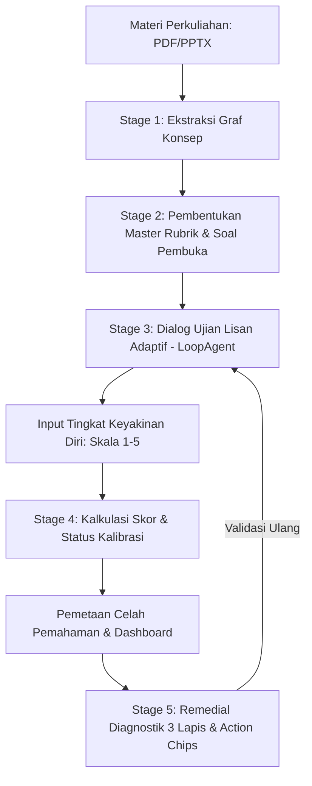

# Nalar

> Platform verifikasi pemahaman konseptual dan simulasi ujian lisan berbasis kecerdasan buatan.

[](https://www.python.org/)
[](https://fastapi.tiangolo.com/)
[](https://ai.google.dev/)
[](https://supabase.com/)
[](LICENSE)

---

## Deskripsi Proyek

Nalar adalah sistem verifikasi pemahaman akademik (*Pre-exam Understanding Verification Tool*) yang memvalidasi penguasaan materi secara mendalam melalui simulasi ujian lisan interaktif berbasis materi perkuliahan pengguna (dokumen PDF, presentasi, atau catatan studi).

Berbeda dari instrumen kuis pilihan ganda atau flashcard konvensional, Nalar mengukur kedalaman kognitif secara terstruktur dan mengidentifikasi fenomena *overconfidence* (kondisi saat pengguna merasa telah menguasai materi padahal pemahaman aktual masih berada di tingkat permukaan).

---

## Fitur Utama

1. **Adaptive Oral Examiner Engine**
   * Pengujian bertingkat berbasis *Bloom's Taxonomy* (`definisi` -> `sebab-akibat` -> `transfer`).
   * Evaluasi ketat pada mode ujian tanpa membocorkan kunci jawaban atau penjelasan materi selama proses berlangsung.
   * Toleransi kontekstual terhadap terminologi teknis informal serta mitigasi terhadap input irelevan (*adversarial input guard*).

2. **Confidence Calibration & Skor Kesadaran Diri**
   * Pengukuran tingkat keyakinan diri pengguna (skala 1-5) sebelum hasil evaluasi ditampilkan untuk dibandingkan dengan *Depth Score* aktual.
   * Klasifikasi status kalibrasi: `accurate`, `overconfident`, atau `underconfident`.

3. **Depth Score & Evidence Trail**
   * Kalkulasi kuantitatif skor kedalaman pemahaman (0-100%) yang dilengkapi bukti kutipan spesifik (*evidence trail*) dari respons pengguna.

4. **Diagnostic Remedial & Smart Action Chips**
   * Penyajian materi remedial melalui pendekatan 3 lapis: analogi dunia nyata (*mental anchor*), dekonstruksi salah kaprah (*misconception deconstruction*), dan referensi materi teknis (*technical bridge*).
   * Fitur interaksi terpandu (*action chips*) untuk eksplorasi materi lebih lanjut serta pengujian ulang ringkas (*mini re-test*).

5. **Mode Institusional / Dosen**
   * Manajemen kelas, distribusi silabus, dan pemantauan analitik agregat maupun individual berbasis izin eksplisit pengguna.

---

## Arsitektur Sistem



---

## Struktur Direktori

```text
Nalar/
├── README.md                           # Dokumentasi utama repositori
├── Nalar-Dokumen-Perancangan-Produk.md # Dokumentasi spesifikasi produk komprehensif
├── ai-service/                         # Microservice AI (Python & FastAPI)
│   ├── .env.example                    # Templat konfigurasi lingkungan
│   ├── requirements.txt                # Dependensi pustaka Python
│   └── app/
│       ├── main.py                     # Titik masuk utama server FastAPI
│       ├── config.py                   # Manajemen konfigurasi berbasis Pydantic Settings
│       ├── agents/                     # Modul Google ADK LoopAgent (Stage 3)
│       ├── endpoints/                  # Handler rute API (Stage 1 hingga 5)
│       ├── prompts/                    # Templat instruksi sistem LLM (.md)
│       ├── schemas/                    # Kontrak skema validasi Pydantic
│       ├── services/                   # Logika kalkulasi skor dan kalibrasi
│       └── static/                     # Antarmuka sandbox pengujian lokal (playground.html)
└── docs/
    └── PRD/
        ├── prd-ai-module.md            # PRD teknis modul AI
        ├── context/                    # Dokumen konteks dan alur kerja tim
        └── contracts/                  # Spesifikasi API, skema output, dan skema database
```

---

## Panduan Instalasi dan Menjalankan Layanan

### Prasyarat Sistem
* Python 3.13 atau versi yang lebih baru
* Kunci akses Google Gemini API ([Google AI Studio](https://aistudio.google.com/))

### Langkah Instalasi

1. Navigasi ke direktori layanan AI:
   ```bash
   cd ai-service
   ```

2. Buat dan aktifkan lingkungan virtual (opsional namun disarankan):
   ```bash
   python -m venv .venv
   source .venv/bin/activate      # Linux / macOS
   # atau .venv\Scripts\activate  # Windows
   ```

3. Pasang seluruh dependensi proyek:
   ```bash
   pip install -r requirements.txt
   ```

4. Konfigurasikan variabel lingkungan:
   ```bash
   cp .env.example .env
   ```

   Perbarui berkas `.env` dengan kredensial API yang valid:
   ```env
   GEMINI_API_KEY=your_gemini_api_key
   DEFAULT_LLM_MODEL=gemini-2.5-flash
   ```

### Menjalankan Server Pengembangan

Jalankan server aplikasi menggunakan Uvicorn:
```bash
python -m uvicorn app.main:app --reload --port 8000
```

Setelah server aktif:
* Dokumentasi interaktif Swagger UI dapat diakses melalui: `http://localhost:8000/docs`
* Antarmuka pengujian lokal (sandbox) dapat diakses melalui: `http://localhost:8000/playground`

---

## Lisensi

Proyek ini didistribusikan di bawah ketentuan lisensi [MIT License](LICENSE).
